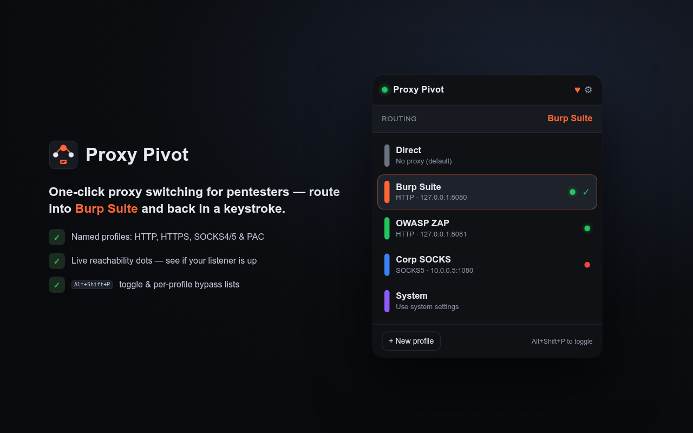

# Proxy Pivot

  

A fast, no-nonsense proxy switcher for Chrome — built for pentesters who live in Burp
Suite, ZAP, or a SOCKS tunnel and want to flip traffic in and out with one click.

  
  
  

## Features

- **One-click switching** — pick a profile from the popup, traffic reroutes instantly.
- **Burp-ready out of the box** — ships with a `Burp Suite` profile aimed at
  `127.0.0.1:8080`.
- **Keyboard toggle** — `Alt+Shift+P` flips the last-used proxy on/off without opening
  the popup. Great for "route this request through Burp, then back to direct".
- **HTTP / HTTPS / SOCKS4 / SOCKS5** fixed servers, plus **PAC script** (URL or inline)
  and **System settings** modes.
- **Per-profile bypass lists** — hosts that should skip the proxy. `localhost`,
  `127.0.0.1`, and `<local>` are always bypassed so your tooling stays reachable.
- **At-a-glance status** — a colored badge (`ON` / `SYS`) on the toolbar icon, a status
  dot in the popup, and per-profile color tags so you always know what's live.
- **Reachability test** — the popup auto-probes every fixed-server profile on open and
  shows a live health dot (🟢 up / 🔴 refused / 🟡 no response); click a dot to re-test.
  The editor has a **Test reachability** button with latency. Answers "is Burp actually
  listening on 8080?" before you waste time chasing dead traffic.
- **Synced profiles** — stored in `chrome.storage.sync`, so they follow your Chrome
  profile across machines.

## Install (unpacked)

1. Open `chrome://extensions`.
2. Enable **Developer mode** (top-right).
3. Click **Load unpacked** and select this `proxy-pivot/` folder.
4. Pin the icon from the extensions menu for quick access.

Works in any Chromium browser that supports Manifest V3 and the `proxy` API (Chrome,
Edge, Brave, etc.).

## Usage

- Click the icon → choose a profile (**Direct** = no proxy, **System** = OS settings).
- Click **⚙ / New profile** to open the editor: name it, set protocol + host + port,
  add bypass entries, pick a color, save. Changes apply immediately.
- Press `Alt+Shift+P` anywhere to toggle between Direct and your last active proxy.
  Rebind it at `chrome://extensions/shortcuts`.

## Typical setup for Burp

1. In Burp: **Proxy → Proxy settings → Proxy listeners**, confirm a listener on
   `127.0.0.1:8080`.
2. In Proxy Pivot: click **Burp Suite** (already there). Badge shows **ON**.
3. Install Burp's CA cert in Chrome so HTTPS interception doesn't throw cert errors.
4. Done — toggle with `Alt+Shift+P` as you work.

## Reachability test — how it reads

Chrome extensions can't open raw TCP sockets, so the probe does a direct `fetch` to
`http://host:port`:

| Result | Meaning |
|--------|---------|
| 🟢 **up** | Something answered the TCP connection — the listener is alive. |
| 🔴 **down** | Connection refused — nothing is listening there. |
| 🟡 **unknown** | Timed out / filtered — a firewall or non-HTTP service may be swallowing it. |

Probes target the proxy host directly and `127.0.0.1` is always in the bypass list, so the
test stays accurate even while a proxy is active. It's reliable for **HTTP(S)** proxies
(Burp, ZAP, mitmproxy). A **SOCKS-only** port is open but doesn't speak HTTP, so it can
report *down*/*unknown* while actually running — treat SOCKS results as advisory.

## How it works

`background.js` is the single source of truth. It calls
`chrome.proxy.settings.set({ scope: "regular" })` with a config built from the active
profile, persists state to `chrome.storage.sync`, and keeps the toolbar badge in sync.
The popup and options page are thin UIs that message the worker.

## Files

| File | Role |
|------|------|
| `manifest.json` | MV3 manifest, permissions, command shortcut |
| `background.js` | Proxy state owner (service worker) |
| `popup.html/.css/.js` | Quick-switch popup |
| `options.html/.css/.js` | Profile editor (CRUD) |
| `icons/` | Toolbar icons (+ `render.py` source) |

## Notes & scope

- Uses `chrome.proxy`, which controls the **whole browser's** proxy, not per-tab. That
  matches how SwitchyOmega and similar tools work.
- Only intended for authorized testing on systems you own or have permission to assess.

## Support

Proxy Pivot is free and open-source — no features are locked. If it saves you time on an
engagement, you can buy me a coffee. Totally optional, and much appreciated.

